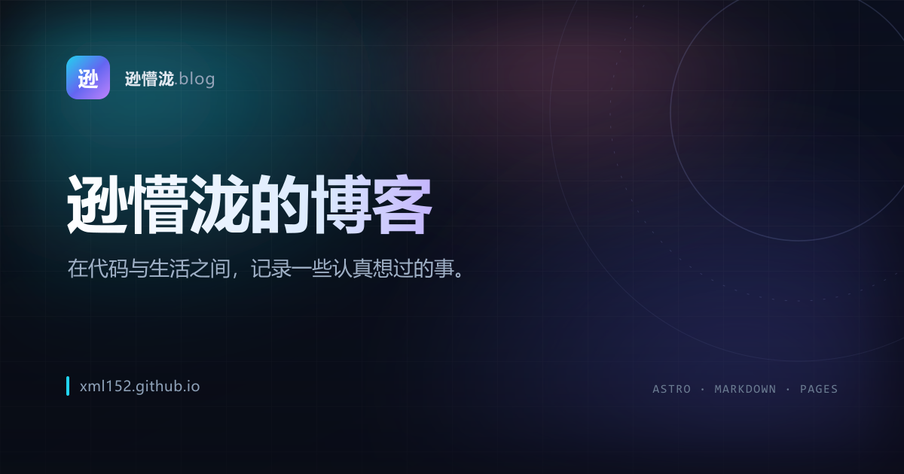

# Aurora Blog

一个用 **Astro + Markdown** 写的个人博客模板，为 GitHub Pages 定制。

干净的排版、克制的动效、构建期生成的全文搜索，默认零客户端框架。写作只需要新建一个 `.md` 文件。

> 🤖 **本模板由 DeepSeek 生成**，之后由站主按自己的喜好调整。你可以自由修改、删减，页脚署名可在 `site.config.ts` 的 `footer.credit` 里改或移除。



## 预览

| 首页（亮色） | 文章页 |
| --- | --- |
|  |  |

| 首页（移动端） | 文章页（暗色） |
| --- | --- |
|  |  |

> 截图由无头浏览器实际渲染生成，位于 `docs/preview/`。

## 特性

- **写作体验**：`src/content/posts/` 下写 Markdown，frontmatter 类型校验，草稿自动隐藏
- **内容组织**：分类 + 标签 + 按年份归档 + 分页
- **全文搜索**：Pagefind 在构建时生成静态索引，`Ctrl/⌘ + K` 唤起，无需后端
- **阅读体验**：中文优化排版、右侧目录（滚动高亮）、阅读进度、代码高亮（亮暗双主题）、一键复制
- **深浅色**：跟随系统 / 手动切换，localStorage 记忆，无闪烁
- **SEO**：每页 title/description/canonical、OpenGraph/Twitter Card、JSON-LD、RSS、sitemap
- **部署**：GitHub Actions 自动构建并发布，推送即上线
- **零 JS 框架**：全站客户端 JS 不到 5KB（不含搜索索引）

## 快速开始

需要 Node.js ≥ 20.3。

```bash
npm install
npm run dev        # http://localhost:4321
```

构建并预览：

```bash
npm run build      # astro build + pagefind 生成搜索索引
npm run preview
```

> 搜索索引在构建后生成，所以 `npm run dev` 下搜索会提示「索引未生成」，属于正常现象。要本地体验搜索，请用 `npm run build && npm run preview`。

## 目录结构

```
.
├── site.config.ts              # 站点配置：标题、导航、社交链接、分页数…
├── astro.config.mjs            # Astro 配置：站点地址、sitemap、代码主题
├── pagefind.yml                # 搜索索引配置（索引正文、忽略侧栏）
├── .github/workflows/deploy.yml
├── public/                     # 静态资源：头像、封面、favicon、OG 图
└── src/
    ├── content.config.ts       # 文章 frontmatter 的字段定义（zod）
    ├── content/posts/          # 文章 Markdown
    ├── components/             # Header / Hero / PostCard / Sidebar / Toc / Search…
    ├── layouts/                # BaseLayout / BlogLayout
    ├── pages/                  # 路由：首页分页、文章、归档、标签、分类、关于、RSS
    ├── styles/                 # tokens / base / layout / components / prose
    └── utils/posts.ts          # 排序、阅读时长、归档分组等工具函数
```

## 写一篇文章

在 `src/content/posts/` 新建 `my-post.md`，文件名就是 URL（`/posts/my-post/`）。完整模板见 [`docs/post-template.md`](docs/post-template.md)：

```markdown
---
title: '文章标题'
description: '一两句话摘要，会用在列表卡片和 SEO 描述里'
published: 2026-11-24
updated: 2026-11-25        # 可选
category: 技术              # 单选，用于分类归档
tags: ['Astro', '前端']     # 多选
cover: /covers/aurora.jpg  # 可选，不填用站点默认封面
coverAlt: '封面描述'
draft: false               # true 时生产构建不输出
pinned: false              # true 时首页置顶
---

正文从这里开始，支持 **GFM**：表格、任务列表、删除线、脚注等。
```

字段说明：

| 字段 | 必填 | 默认值 | 作用 |
| --- | --- | --- | --- |
| `title` | 是 | — | 标题 |
| `description` | 否 | `''` | 摘要 / SEO 描述 |
| `published` | 是 | — | 发布日期 |
| `updated` | 否 | — | 更新日期，文章页会提示 |
| `category` | 否 | `未分类` | 分类，单选 |
| `tags` | 否 | `[]` | 标签，多选 |
| `cover` | 否 | `site.defaultCover` | 封面图 |
| `coverAlt` | 否 | `''` | 封面替代文本 |
| `draft` | 否 | `false` | 草稿开关 |
| `pinned` | 否 | `false` | 首页置顶 |
| `lang` | 否 | `zh-CN` | 文章语言 |

支持 Markdown 子目录（`posts/tech/foo.md` → `/posts/tech/foo/`），但分类请用 `category` 字段，不要靠目录。

## 改成你的站点

1. **`site.config.ts`**：改站点名、标语、作者信息、头像、邮箱、GitHub、导航、每页文章数。
2. **`astro.config.mjs`**：把 `site` 改成你的域名（影响 RSS、sitemap、OG 绝对地址）。
3. **头像**：替换 `public/avatar.jpg`（建议正方形、≥ 512×512），然后重新生成配套图标：

   ```bash
   magick public/avatar.jpg -resize 180x180^ -gravity center -extent 180x180 public/apple-touch-icon.png
   magick public/avatar.jpg -resize 64x64^ -gravity center -extent 64x64 public/favicon.png
   ```
4. **`public/og-default.png`**：社交分享图，1200×630。改 `public/og-default.svg` 后重新导出：

   ```bash
   rsvg-convert -w 1200 -h 630 public/og-default.svg -o public/og-default.png
   ```

5. **`public/covers/`**：示例封面是抽象图（`.jpg` 用于页面与分享图），同目录的 `.svg` 是可编辑源文件。换成自己的图片即可。

### 换配色

所有颜色、圆角、阴影都在 `src/styles/tokens.css`。改这几个变量就能整体换肤：

```css
:root {
  --accent: #0a7e8f;   /* 主色 */
  --violet: #6a5ae8;   /* 渐变辅色 */
  --bg: #fbfbf9;       /* 背景 */
  --text: #1b2129;     /* 正文 */
}
html[data-theme='dark'] { /* 暗色对应值 */ }
```

## 部署到 GitHub Pages

仓库名是 `用户名.github.io` 时，站点就在根路径（本模板默认）。

1. 把代码推到 `main` 分支。
2. 仓库 **Settings → Pages → Build and deployment → Source** 选择 **GitHub Actions**。
3. 之后每次 push 到 `main`，`.github/workflows/deploy.yml` 会自动构建并发布。

如果部署在子路径（例如 `username.github.io/blog`），需要在 `astro.config.mjs` 里加：

```js
export default defineConfig({
  site: 'https://username.github.io',
  base: '/blog',
});
```

同时把 `site.url` 改成带子路径的地址，并检查站内绝对路径（`/covers/...`、`/rss.xml`）是否仍然适用。

## 常见问题

**搜索为什么没结果？**
`npm run build` 之后才会生成 `dist/pagefind/`。开发模式下无索引。

**阅读时长和字数怎么算的？**
`src/utils/posts.ts` 里按「中文 350 字/分钟 + 英文 220 词/分钟」估算，可按需调整。

**想加评论？**
推荐 Giscus（基于 GitHub Discussions）。在文章页底部插入其 script 即可，无需改动构建流程。

**怎么让 AI 帮忙整理草稿？**
直接把手写笔记、语音转文字、零散链接发过来，说明「分类 / 标签 / 是否要封面」即可。输出会遵循 `docs/post-template.md` 的约定：`##` 起步的标题层级、标注语言的代码块、中文标点、每段不硬换行。整理完可以直接落盘到 `src/content/posts/`。

**想加图片灯箱 / 数学公式？**
图片灯箱可加一个约 30 行的原生脚本；数学公式装 `remark-math` + `rehype-katex` 后在 `astro.config.mjs` 注册。

**能不能用 MDX？**
可以：`npm i @astrojs/mdx` 并在配置里注册，然后把 `content.config.ts` 的 `pattern` 改成 `**/*.{md,mdx}`。

## 技术栈

[Astro 5](https://astro.build) · [Pagefind](https://pagefind.app) · [Shiki](https://shiki.style) · GitHub Pages

## License

代码 MIT，示例文字内容 CC BY-NC-SA 4.0。

模板由 [DeepSeek](https://www.deepseek.com) 生成，站主二次调整。
